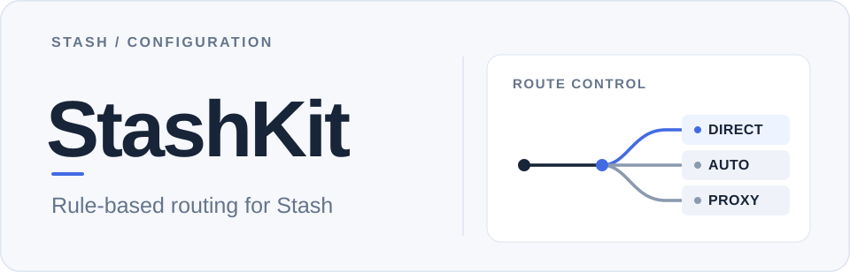

<p align="center">
  <picture>
    <source media="(max-width: 600px) and (prefers-color-scheme: dark)" srcset="./docs/assets/stashkit-hero-mobile-dark.svg" />
    <source media="(max-width: 600px)" srcset="./docs/assets/stashkit-hero-mobile-light.svg" />
    <source media="(prefers-color-scheme: dark)" srcset="./docs/assets/stashkit-hero-wide-dark.svg" />
    
  </picture>
</p>

<p align="center"><strong>不同服务，按规则选择合适的线路。</strong></p>

<p align="center">
  StashKit 是面向 <a href="https://stash.wiki/">Stash</a> 的模块化 YAML 分流配置。<br />
  保留 LoonKit 的 40 个业务策略组，使用远程规则集处理 AI、金融、流媒体、社交、游戏和国内服务。
</p>

<p align="center">
  <a href="https://raw.githubusercontent.com/YohakuSama/stashkit/main/StashKit-Subscription.yaml"><strong>获取订阅版配置</strong></a> ·
  <a href="https://raw.githubusercontent.com/YohakuSama/stashkit/main/StashKit-SelfHosted.yaml"><strong>获取自建版配置</strong></a> ·
  <a href="#快速开始">快速开始</a> ·
  <a href="./docs/VALIDATION.md">验收与排查</a>
</p>

<p align="center"><sub>先下载并在本地填写自己的订阅或节点，再导入 Stash；仓库不提供代理节点和订阅。</sub></p>

当前配置：**v0.1.20** · 对齐 [LoonKit v7.0.13](https://github.com/YohakuSama/loonkit/tree/66b01bffe8982d6a8153af7b03c897dc1bbab648) 的 Crypto 远程规则 · [更新记录](./docs/CHANGELOG.md) · [CI](https://github.com/YohakuSama/stashkit/actions/workflows/ci.yml) · [GPL-2.0-only](./LICENSE)

---

## 功能概览

**分类分流** — 40 个原生策略组，按基础选路、AI、平台与金融、流媒体、社交、游戏排列。国内常用服务优先直连，海外服务按组选择线路，末尾由 `Final` 决定未匹配请求。

**规则按需远程加载** — 正式在线配置引用 **55 份独立、固定提交的远程规则文件**：54 份经审查的 Stash 原生规则集，加一份来自 LoonKit v7.0.13 的 **219 条 Crypto 域名规则集**。规则不铺进主 YAML；Stash 下载并缓存各 Provider，缓存过期可重新拉取相同的不可变快照。

**节点独立管理** — `Proxy` 的固定选择顺序为 **Auto → Fallback → REJECT**，之后才是订阅或自建的具体节点；订阅版通过 `Airport` Provider 自动更新节点；自建版的单节点模板使用明确的 `SelfHosted` 引用；多节点使用构建器读取个人 `proxies` 并显式生成全部节点名称，不再混用 `include-all`。规则、节点和策略组各司其职，不必为更新服务规则重写节点列表。

## 快速开始

| 使用场景 | 入口 | 需要填写的内容 |
| --- | --- | --- |
| 机场提供 Clash / Stash YAML 节点订阅 | [StashKit-Subscription.yaml](./StashKit-Subscription.yaml) | `proxy-providers.Airport.url` |
| 自建 VPS / 手动维护 1～N 个节点 | [StashKit-SelfHosted.yaml](./StashKit-SelfHosted.yaml) | 单节点直接改占位参数；多节点按下方命令生成个人文件 |
| 公共 DoH 希望优先走代理 | [StashKit-Privacy.yaml](./StashKit-Privacy.yaml) | 同订阅版的 `Airport.url` |
| 事先安装全部规则资源、离线启动 | [StashKit-Local.yaml](./StashKit-Local.yaml) | 本地节点来源与 55 份规则文件 |

1. **备份**：导出你当前的 Stash 配置，确认私人订阅和密钥没有存放在公开仓库。
2. **选择并下载**：只选上表中与你的节点管理方式对应的一份 YAML，保存为本地文件。
3. **填入节点来源**：使用编辑器修改下方示例所示字段，**不要**修改 `rule-providers` 的固定远程 URL 或乱改 `proxy-groups` 引用。
4. **导入 Stash**：从配置文件管理界面导入本地文件，选中并启用；等待首次远程规则加载完成，再检查 `Proxy`、`Auto`、`Fallback` 及业务组。
5. **验收流量**：核对请求记录中的规则、策略、节点和最终出口；特别检查国内直连、广告拦截、Crypto 与 DNS。参见[验收清单](./docs/VALIDATION.md)。

> [!IMPORTANT]
> 公开模板使用 `example.invalid` 作为无效节点占位，**直接导入不等于已经拥有可用节点**。请先填写私人来源。代理中断、空订阅、无缓存规则集都需要单独测试；CI 通过不代表你的设备已验证。

### 订阅用户：只改 Airport 的 URL

```yaml
proxy-providers:
  Airport:
    url: 'https://example.invalid/REPLACE-WITH-YOUR-CLASH-SUBSCRIPTION'
    path: ./providers/stashkit-airport.yaml
    interval: 3600
```

将 `url` 换为**返回顶层 `proxies` 列表的 HTTPS Clash/Stash YAML 订阅**，其他字段保留。普通 Base64 节点文本不是此 Provider 直接支持的 YAML。订阅每 3600 秒可刷新节点；不要把含 Token 的地址提交到 GitHub。`StashKit.yaml` 是订阅版的兼容入口，内容保持相同。

### 自建用户：显式节点引用，不混用 include-all

**为什么改了？** v0.1.13 正式版使用 `use: [Airport]` 订阅方式，不使用自建模板的 `include-all`。从 v0.1.16 起自建版采用 `include-all: true`，实际已有设备报告 VPN 启动后 `Proxy` 只剩节点、Auto/Fallback/REJECT 消失。v0.1.19 仅调整排版未能解决；v0.1.20 自建版不再依赖这种组合。

[下载自建模板](./StashKit-SelfHosted.yaml) 的顶层 `proxies:` 默认只有 **`SelfHosted` 一个无效占位节点**，其 38 个节点策略组也明确引用 `SelfHosted`。如果只有一个节点，**保留 `name: SelfHosted` 不变，只替换协议、服务器、端口、密钥等实际字段**，保存后即可导入。不要把带占位值的模板直接启用。

**有两个或更多节点、或要使用自己的节点名称**时，不能仅把多个节点粘到公开模板：纯 YAML 无法在不使用 `include-all` 的情况下自动把新增名称写入 38 个策略组。请从仓库运行**通用生成器**：

```sh
git clone https://github.com/YohakuSama/stashkit.git
cd stashkit
python -m pip install -r requirements-dev.txt
mkdir -p dist
cp StashKit-SelfHosted.yaml dist/nodes-source.yaml
# 编辑 dist/nodes-source.yaml，只替换顶层 proxies: 为自己的真实节点列表
python scripts/build_loon_selection.py --layout flat \
  --nodes-from dist/nodes-source.yaml \
  --output dist/StashKit-Personal.yaml
```

无论节点叫香港、日本、VLESS、Mieru、Hysteria2，生成器都**从输入自动读取实际 `name`**，不会在公开仓库写死任何私人节点。生成结果的 `Proxy` 固定按 **Auto → Fallback → REJECT → 实际节点** 排列，Auto/Fallback 仅列真实节点，业务组也显式引用相同节点；远程分流规则仍是原来 **55 份独立远程 Provider**，不会复制到本地。

将 **`dist/StashKit-Personal.yaml`** 导入 Stash，而不是 `dist/nodes-source.yaml`。每次添加、删除或重命名静态节点后重新生成并导入。个人配置可能包含节点密钥，不要提交到 GitHub。如果只用 iPhone、无法运行 Python，可选择与 v0.1.13 相同的 [Airport YAML 订阅模式](./StashKit-Subscription.yaml)，而不是依赖静态自建模板自动发现多个节点。

## 规则、优先级与同步边界

正式配置保留独立的 `rule-providers` 和 `RULE-SET`，不在 YAML 中展开 219 条 Crypto 域名，也不把 54 份大型规则复制到本地。现有 54 份规则继续使用审查过的 v0.1.4 冻结资源，Crypto 则单独同步到 LoonKit v7.0.13 的 219 条固定快照；不会因为 LoonKit 或 GitHub `main` 改动而静默换规则。

规则顺序为 **WebRTC 防护 → 局域网直连 → 精确服务例外 → AdBlock → Crypto → 国内与其他服务 → Final**。旧版广告快照对 `coincheck.com` 主页存在误拦，当前通过**仅针对该主机的一条精确例外**与 LoonKit v7.0.13 对齐；其余广告遥测仍先进入 AdBlock。只有冷启动必需的 **133 条 Private-local 私网匹配器**继续内嵌，避免 LAN / DNS 防护首次启动就依赖远程下载。

在线版首次使用需要网络获取规则；离线版必须另行安装带版本目录的 55 份资源，**单独下载 YAML 无法自动安装离线规则包**。使用说明见[规则目录](./rules/README.md)、[路由优先级](./docs/ROUTING.md)和[架构说明](./docs/ARCHITECTURE_AUDIT.md)。

## 使用与排查

- **没有节点或 VPN 启动后选项消失**：先确认用的是订阅版还是自建版，检查实际提供的订阅内容或顶层 `proxies`，重新启用导入的配置。`Proxy` 应同时含 Auto、Fallback、REJECT 与真实节点。若启动前后成员列表改变，先用[运行时验收](./docs/VALIDATION.md)排查，不要将静态 YAML 校验当成真机修复；需要固定排序时在 Stash 网络设置中选择按配置顺序而非延迟排序。
- **Crypto 没走预期出口**：检查域名是否命中 `Crypto-domain`、是否先匹配广告规则，以及 Crypto 策略组选中了哪个节点；`Final` 或国家 IP 规则并不能替代域名匹配。
- **部分流媒体或 App 不可用**：先查看实际请求记录，尤其共享 CDN、登录、支付与统计接口，不应随意将大型公共根域归入特定服务。
- **DNS / WebRTC**：默认使用 AliDNS DoH、Fake-IP 和常见 STUN/TURN 端口防护；它们不能保证未由 Tunnel 接管的所有流量也不会泄露。公共 DoH 的选路与系统 DNS 需要真机核验。

自建多节点请使用上方的 **`--layout flat` 通用构建流程**；不要把新增节点直接粘进单节点占位模板后就导入，也不要将个人密钥上传。订阅用户继续使用与 v0.1.13 一致的 `use: [Airport]` 方式。

## 常见问题

<details>
<summary><strong>为什么规则文件不直接合并进 YAML？</strong></summary>

主配置只负责引用和排序，分类规则在独立远程 Provider 中下载、缓存，避免重复维护和膨胀。远程资源固定到完整提交 SHA，既能按需加载，也可追踪版本和复现内容。

</details>

<details>
<summary><strong>订阅版与自建版可以混用吗？</strong></summary>

两份配置是独立模板。需要多个 Airport、动态 Provider 和静态节点混合管理时，使用[高级节点绑定生成器](./docs/NATIVE_PROVIDER_TRIAL.md)创建自己的配置，不要把两份完整 YAML 拼接。

</details>

<details>
<summary><strong>离线版为什么提示规则集不存在？</strong></summary>

离线 YAML 引用的是 Stash 受管目录中的资源路径。需从 [Releases](https://github.com/YohakuSama/stashkit/releases) 或 CI 获取离线包，校验 SHA256 并按版本目录部署；普通 ZIP 导入不会自动安装规则。

</details>

## 文档导航

**入门与日常使用** · [策略组与节点绑定](./docs/LOON_POLICY_GROUPS.md) · [高级订阅 / 自建配置](./docs/NATIVE_PROVIDER_TRIAL.md) · [真机验证](./docs/VALIDATION.md)

**规则与技术细节** · [远程规则与来源](./rules/README.md) · [路由优先级](./docs/ROUTING.md) · [DNS/网络边界](./docs/ARCHITECTURE_AUDIT.md)

**项目维护** · [更新记录](./docs/CHANGELOG.md) · [v0.1.20 发布说明](./docs/RELEASE_NOTES_v0.1.20.md) · [依赖与第三方声明](./docs/THIRD_PARTY_NOTICES.md) · [GitHub Actions](https://github.com/YohakuSama/stashkit/actions/workflows/ci.yml)

<sub>[Issues](https://github.com/YohakuSama/stashkit/issues) · [GPL-2.0-only](./LICENSE) · 公开仓库不存储个人订阅、节点密钥或运行时凭据</sub>
